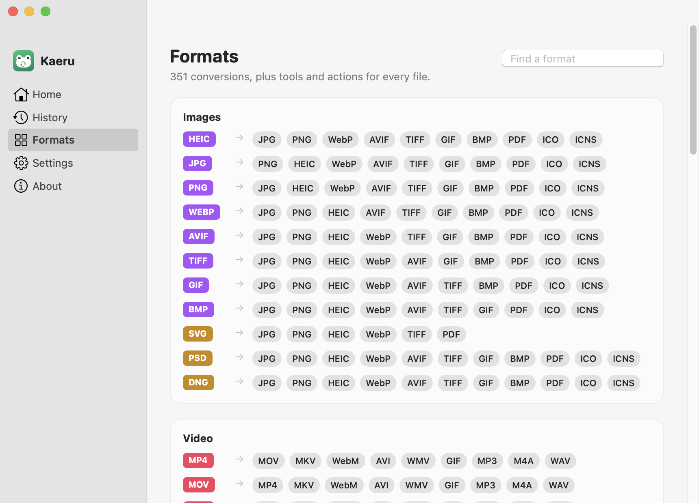

<p align="center">
  
</p>

<h1 align="center">Kaeru</h1>

<p align="center">
  <b>Change any file without opening an app.</b><br>
  Drag a file, hold a key, drop it on what you want. 350+ conversions, all on your Mac.
</p>

<p align="center">
  <a href="https://github.com/NIKSHITH-G/kaeru/releases/latest/download/Kaeru.dmg"><b>Download for macOS</b></a> ·
  <a href="https://getkaeru.vercel.app">Website</a> ·
  <a href="#build-from-source">Build from source</a>
</p>

<p align="center">
  
</p>

> **かえる (kaeru)** is Japanese for both “to change” (変える) and “frog” (蛙). A frog is nature's shape-changer, which is what Kaeru does for files.

## How it works

Start dragging any file, from Finder, the Desktop or any app, then press a key. A wheel opens under your cursor:

| Key | Wheel | What's on it |
| --- | --- | --- |
| ⇧ Shift | **Convert** | HEIC → JPG, MOV → MP4, DOCX → PDF, PDF → PPTX, CSV → XLSX… |
| ⌘ Command | **Tools** | Trim, crop, compress, remove background, OCR, merge, make PDFs searchable… |
| ⌃ Control | **Actions** | AirDrop, Float, Copy, Copy Path, Move To…, Terminal, Reveal |

Drop the file on a slice. The result appears next to the original, and a small card shows progress, with Open, Show in Finder and Cancel buttons.

**No drag needed:** select files in Finder and press **Return**. Renaming and search still work as usual. **⌃⌥M** opens the wheel from anywhere, and you can also drop files on the Dock icon or into the window.

<p align="center">
  
  
</p>

## What it converts

- **Images:** JPG, PNG, HEIC, WebP, AVIF, TIFF, GIF, BMP, PDF, ICO, ICNS. Also reads SVG, PSD and camera RAW files.
- **Video:** MP4, MOV, MKV, WebM, AVI, WMV, GIF. Audio can be extracted to MP3, M4A or WAV.
- **Audio:** MP3, M4A, WAV, FLAC, OGG, Opus, AIFF, WMA.
- **PDF:** PNG or JPG at 300 DPI for every page, PPTX, EPUB, DOCX, Markdown, TXT, RTF, HTML.
- **Documents:** DOCX, PDF, EPUB, Markdown, HTML, RTF, ODT, TXT. Also reads DOC and EPUB. Word tables become Markdown tables.
- **Slides:** PPT, PPTX and Keynote → PDF, PNG, JPG. Uses PowerPoint or Keynote when installed, otherwise a built-in renderer.
- **Pages:** PDF, DOCX, EPUB, RTF or TXT, using the Pages app.
- **Spreadsheets:** XLSX, ODS, CSV, TSV, JSON, HTML, Markdown, PDF. Also reads XLS.
- **Data & subtitles:** JSON ↔ PLIST, JSON pretty-print and minify (key order kept), SRT ↔ VTT, either to TXT.
- **Archives:** ZIP and TAR.GZ. Extracts zip, rar, 7z, tar, gz, bz2 and xz.

**Tools:**
- **Editing:** trim (QuickTime-style), crop (images and video), merge clips, rotate, flip, resize, grayscale.
- **Smaller files:** compress images, video, audio, PDF and JSON, and see how much space you saved.
- **On-device AI:** remove backgrounds, extract text with OCR, and make scanned PDFs searchable.

<p align="center"></p>

## Private by design

Every conversion runs locally, using Apple's frameworks (ImageIO, PDFKit, Vision, AVFoundation) and a bundled FFmpeg. Files are never uploaded. The only network request Kaeru makes is an optional daily check for updates on GitHub.

## Install

**📖 Illustrated guide: [getkaeru.vercel.app/install](https://getkaeru.vercel.app/install)**

Kaeru isn't signed with a paid Apple Developer certificate yet, so macOS asks you to approve it once:

1. **Download** [Kaeru.dmg](https://github.com/NIKSHITH-G/kaeru/releases/latest/download/Kaeru.dmg). It saves to your Downloads folder.
2. **Double-click `Kaeru.dmg`.** A window opens showing Kaeru and an Applications folder.
3. **Drag the Kaeru icon onto the Applications folder.** Then eject the disk by clicking ⏏ next to "Kaeru" in Finder's sidebar.
4. **Open Applications** (Finder → ⇧⌘A) and **double-click Kaeru**. macOS says *"Kaeru" Not Opened*. Click **Done**, not Move to Trash.
5. Click the ** Apple menu → System Settings… → Privacy & Security**, then **scroll down to the Security section**.
6. Next to *"Kaeru" was blocked to protect your Mac.*, click **Open Anyway**.
7. In the dialog, click **Open Anyway** again and enter your **password** or use **Touch ID**. Kaeru opens, a 🐸 appears in the menu bar, and the tutorial starts. You only do this once; updates install without it.
8. **Keyboard features (recommended):** in the tutorial, click **Allow Keyboard Access… → Open System Settings**. Under **Privacy & Security → Accessibility**, switch on **Kaeru**. This enables Return in Finder and the Tab trigger.
9. The first time you press Return in Finder, macOS asks whether Kaeru may control **Finder**. Click **Allow**; Kaeru only uses it to read which files you selected.

**On macOS 13 Ventura or 14 Sonoma**, you can replace steps 5–7 with: **right-click Kaeru → Open → Open**.

**"Kaeru is damaged and can't be opened"?** That's the same check. Open **Terminal** (Applications → Utilities), paste this line and press Return:

```bash
xattr -dr com.apple.quarantine /Applications/Kaeru.app
```

**Updating:** 🐸 → **Check for Updates…** → **Install and Relaunch**. Your settings are kept. If Return in Finder stops working after an update, switch Kaeru off and on under Privacy & Security → Accessibility.

**Uninstall:** 🐸 → Quit Kaeru, drag it from Applications to the Trash, and remove it from Privacy & Security → Accessibility (select it, then click −).

You need an Apple silicon Mac with macOS 13 or later. Background removal needs macOS 14.

## Build from source

You need the Xcode Command Line Tools and Homebrew.

```bash
brew install ffmpeg webp
swift build && .build/debug/Kaeru --self-test   # unit checks
tests/e2e.sh                                     # runs every conversion on generated files
scripts/build-app.sh --install                   # build/Kaeru.app → /Applications
scripts/build-app.sh --bundle-helpers && scripts/make-dmg.sh   # self-contained build/Kaeru.dmg
```

To release, push a tag like `v1.0.0`. GitHub Actions then builds, tests and attaches `Kaeru.dmg` to the release, and installed copies offer the update.

### Headless CLI

Every operation also runs without the UI:

```bash
Kaeru --list photo.heic                        # operation ids for each wheel
Kaeru --run image.jpg photo.heic               # → photo.jpg
Kaeru --run pdf.combine a.pdf b.png            # → Combined.pdf
KAERU_TRIM=1-4 Kaeru --run video.trim clip.mp4  # editor input from environment variables
```

### Project layout

| Path | What's there |
| --- | --- |
| `Sources/Kaeru/Wheel/` | Global drag detection, the radial wheel, drop handling |
| `Sources/Kaeru/Core/Registry.swift` | Which operations each file kind offers |
| `Sources/Kaeru/Converters/` | Image, media, PDF, document, spreadsheet, EPUB, PPTX, ODS and archive engines |
| `Sources/Kaeru/Editors/` | Trim and crop windows, merge |
| `Sources/Kaeru/App/` | Menu bar, main window, tutorial, keyboard hooks, updater |
| `Sources/Kaeru/UI/` | Theme, artwork drawn in code, shared components |

## License

MIT for Kaeru's own code. Release builds bundle FFmpeg (GPL) and cwebp (BSD); see [LICENSE](LICENSE).
