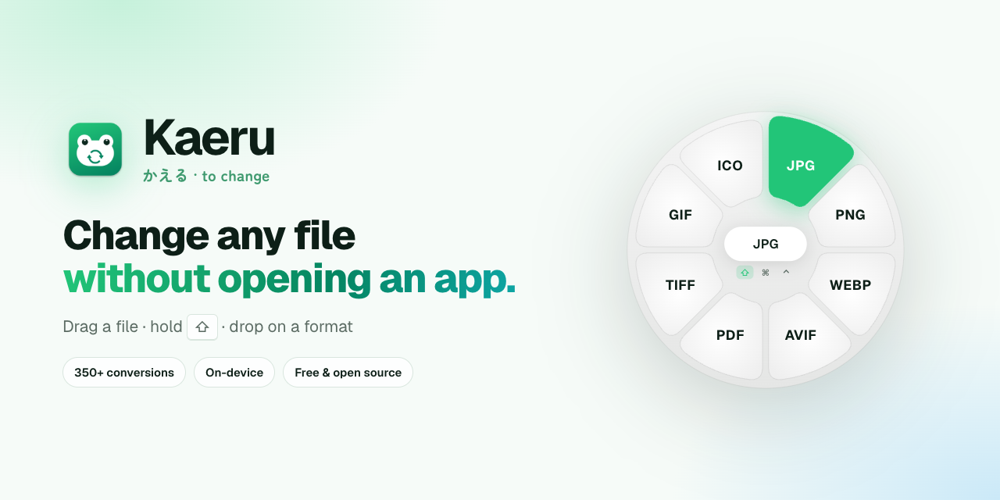
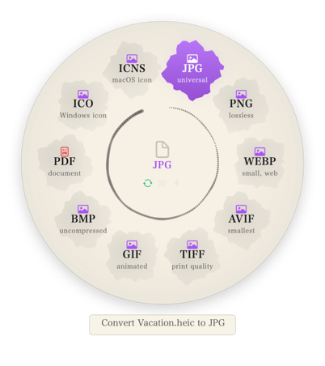
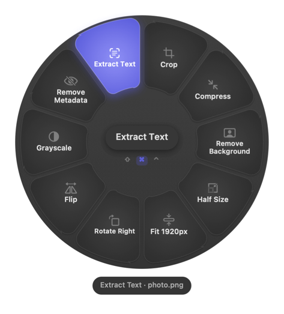
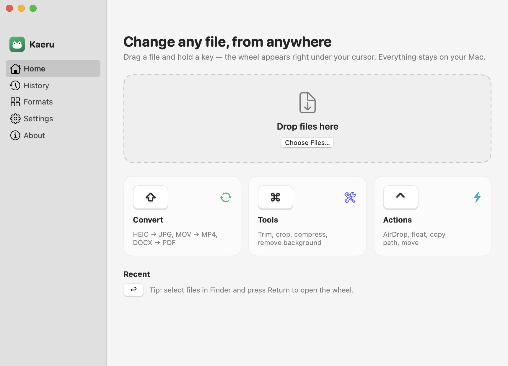

<a href="https://getkaeru.vercel.app">
  <picture>
    <source media="(prefers-color-scheme: dark)" srcset="docs/images/banner-dark.png">
    
  </picture>
</a>

<p align="center">
  <a href="https://github.com/NIKSHITH-G/kaeru/releases/latest"></a>
  <a href="https://github.com/NIKSHITH-G/kaeru/actions/workflows/ci.yml"></a>
  
  
  <a href="LICENSE"></a>
</p>

<p align="center">
  <a href="https://github.com/NIKSHITH-G/kaeru/releases/latest/download/Kaeru.dmg"></a>
</p>

<p align="center">
  <a href="https://getkaeru.vercel.app/install">Install guide</a>
  &nbsp;·&nbsp; <a href="https://getkaeru.vercel.app">Website</a>
  &nbsp;·&nbsp; <a href="docs/kaeru-promo.mp4">25-second video</a>
</p>

<p align="center">
  
</p>

> **かえる (kaeru)** means both “to change” (変える) and “frog” (蛙) in Japanese. A frog is nature's shape-changer, which is what Kaeru does for files.

---

## How it works

Start dragging any file, from Finder, the Desktop or any app, then press a key. A wheel opens under your cursor; drop the file on what you want.

| Hold | Wheel | For example |
| :---: | --- | --- |
| **⇧ Shift** | **Convert** | HEIC → JPG · MOV → MP4 · DOCX → PDF · PDF → PPTX · CSV → XLSX |
| **⌘ Command** | **Tools** | Trim · Crop · Compress · Remove background · Extract text (OCR) · Merge |
| **⌃ Control** | **Actions** | AirDrop · Float · Copy · Copy path · Move to… · Terminal · Reveal |

The result appears next to the original. A small card shows progress and lets you **Open**, **Show in Finder** or **Cancel**.

**No drag needed:** select files in Finder and press **Return** (renaming still works as usual), or press **⌃⌥M** from anywhere. You can also drop files on the Dock icon or into Kaeru's window. You can change any wheel's key in Settings: ⇧ ⌘ ⌃ ⌥, fn or ⇥ Tab.

<p align="center">
  
  &nbsp;&nbsp;
  
</p>

## What it can do

<table>
<tr><td width="50%" valign="top">

**Convert**
- **Images:** JPG, PNG, HEIC, WebP, AVIF, TIFF, GIF, BMP, PDF, ICO, ICNS. Also reads SVG, PSD and camera RAW files.
- **Video:** MP4, MOV, MKV, WebM, AVI, WMV, GIF. Audio can be extracted to MP3, M4A or WAV.
- **Audio:** MP3, M4A, WAV, FLAC, OGG, Opus, AIFF, WMA.
- **PDF:** PNG or JPG for every page at 300 DPI, PPTX, EPUB, DOCX, Markdown, TXT, RTF, HTML.
- **Documents:** DOCX, PDF, EPUB, Markdown, HTML, RTF, ODT, TXT. Also reads DOC. Word tables become Markdown tables.
- **Slides:** PPT, PPTX and Keynote → PDF, PNG, JPG.
- **Spreadsheets:** XLSX, ODS, CSV, TSV, JSON, HTML, Markdown, PDF. Also reads XLS.
- **Pages:** PDF, DOCX, EPUB, RTF or TXT, using the Pages app.
- **Data & subtitles:** JSON ↔ PLIST, SRT ↔ VTT, either to TXT.
- **Archives:** ZIP and TAR.GZ. Extracts zip, rar, 7z, tar, gz, bz2 and xz.

</td><td width="50%" valign="top">

**Tools**
- **Edit:** trim (QuickTime-style), crop with aspect presets, merge clips, rotate, flip, resize, grayscale.
- **Shrink:** compress images, video, audio, PDFs and Office files, and see how much space you saved.
- **On-device AI:** remove backgrounds, extract text (OCR), make scanned PDFs searchable.
- **Office:** extract slide text and images, count slides and words.
- **Spreadsheets:** remove duplicates, sort, transpose, trim spaces, count rows.
- **Subtitles:** shift timing by ±1s, remove formatting.
- **Archives & folders:** list contents, test integrity, folder of images → PDF.

**Actions**
- AirDrop, Float (a sticky shelf above all windows), Copy, Copy Path, Move To…, open Terminal here, Reveal in Finder.

</td></tr>
</table>

Every file type has something on every wheel, and the ⌘ wheel is never empty.

<p align="center">
  
  
</p>

## Install

**📖 Illustrated step-by-step guide: [getkaeru.vercel.app/install](https://getkaeru.vercel.app/install)**

Kaeru isn't signed with a paid Apple Developer certificate yet, so macOS asks you to approve it **once**:

1. **Download** [Kaeru.dmg](https://github.com/NIKSHITH-G/kaeru/releases/latest/download/Kaeru.dmg) (about 20 MB, FFmpeg included) and **double-click it**.
2. **Drag the Kaeru icon onto the Applications folder** in the window that opens. Then eject the disk with ⏏ in Finder's sidebar.
3. Open **Applications** (Finder → ⇧⌘A) and **double-click Kaeru**. macOS says *“Kaeru” Not Opened*. Click **Done**, not Move to Trash.
4. Open ** Apple menu → System Settings… → Privacy & Security** and **scroll down to Security**.
5. Next to *“Kaeru” was blocked to protect your Mac*, click **Open Anyway**. Click **Open Anyway** again and enter your password or use Touch ID.
6. Kaeru opens, a 🐸 appears in your menu bar, and a 30-second tutorial lets you try the wheel on a sample file.

On **macOS 13 or 14**, steps 4–5 can be replaced with **right-click Kaeru → Open → Open**.

<details>
<summary><b>“Kaeru is damaged and can't be opened”</b></summary>

That's the same first-launch check, shown differently. Open **Terminal** (Applications → Utilities → Terminal), paste this line, press Return, and open Kaeru again:

```bash
xattr -dr com.apple.quarantine /Applications/Kaeru.app
```
</details>

### Permissions

Kaeru asks for two optional permissions. Both stay on your Mac, and neither is needed to convert files by dragging.

| Permission | Where | Why |
| --- | --- | --- |
| **Accessibility**<br><sub>called *Device Control and Data Access* on newer macOS</sub> | System Settings → Privacy & Security | **Return in Finder** and the ⇥ Tab trigger. Kaeru's tutorial and Settings have an **Open System Settings** button. |
| **Automation** (Finder, PowerPoint, Keynote, Pages) | macOS asks the first time | Reading your Finder selection, and exporting slides or Pages documents with those apps. |

**Switched on but Kaeru still asks?** In that list, select **Kaeru**, click **−**, then click **+**, choose **Applications → Kaeru**, and switch it on. From 0.9.4, every release is signed with the same certificate, so updates keep these permissions.

### Update and uninstall

- **Update:** 🐸 → **Check for Updates…** → **Install and Relaunch**. Kaeru also checks once a day. Settings and history are kept.
- **Uninstall:** 🐸 → **Quit Kaeru**, move Kaeru from Applications to the Trash, and remove it from the Accessibility list (select it, then click −).

**Requirements:** an Apple silicon Mac with macOS 13 Ventura or later. Background removal needs macOS 14.

## Private by design

Every conversion runs locally, using Apple's frameworks (ImageIO, PDFKit, Vision, AVFoundation) and a bundled FFmpeg. **Files are never uploaded.** The only network request Kaeru makes is an optional daily update check against GitHub Releases.

---

## For developers

<details>
<summary><b>Build from source</b></summary>

You need the Xcode Command Line Tools (full Xcode isn't required) and Homebrew.

```bash
brew install ffmpeg webp
swift build && .build/debug/Kaeru --self-test      # 38 unit checks
tests/e2e.sh                                        # every operation on 40+ generated file types, outputs validated
scripts/build-app.sh --install                      # build/Kaeru.app → /Applications
scripts/build-app.sh --bundle-helpers && scripts/make-dmg.sh   # self-contained build/Kaeru.dmg
```

**Signing:** builds are signed with the self-signed *Kaeru Signing* certificate when it's available, from `~/Library/Application Support/Kaeru Signing/` locally or GitHub secrets in CI. A stable identity is what lets macOS keep permissions across updates. Without the certificate, builds fall back to ad hoc signing.

**Releasing:** push a tag such as `v1.0.0`. GitHub Actions builds, signs, tests and attaches `Kaeru.dmg`, writing release notes from the commit messages. Installed copies then offer the update.
</details>

<details>
<summary><b>Headless CLI</b></summary>

The same binary runs any operation without the UI:

```bash
Kaeru --list photo.heic                          # operation ids for each wheel
Kaeru --run image.jpg photo.heic                 # → photo.jpg
Kaeru --run pdf.combine a.pdf b.png              # → Combined.pdf
KAERU_TRIM=1-4 Kaeru --run video.trim clip.mp4   # editors take their input from environment variables
KAERU_CROP=0,0,800,600 Kaeru --run image.crop a.png
KAERU_NO_APPS=1 Kaeru --run slides.pdf deck.pptx  # skip PowerPoint/Keynote, use the built-in renderer
```
</details>

<details>
<summary><b>Project layout</b></summary>

| Path | What's there |
| --- | --- |
| `Sources/Kaeru/Wheel/` | Global drag detection, the radial wheel, drop handling |
| `Sources/Kaeru/Core/Registry.swift` | Which operations each file type offers |
| `Sources/Kaeru/Converters/` | Image, media, PDF, document, spreadsheet, EPUB, PPTX, ODS, archive and Office engines |
| `Sources/Kaeru/Editors/` | Trim and crop windows, merge |
| `Sources/Kaeru/App/` | Menu bar, main window, tutorial, keyboard hooks, updater |
| `Sources/Kaeru/UI/` | Theme, artwork drawn in code, shared components |
| `website/` | [getkaeru.vercel.app](https://getkaeru.vercel.app), a Next.js site with a live wheel demo; deploys on push |
| `tests/`, `.github/workflows/` | End-to-end tests, CI and the release pipeline |
</details>

## License

Kaeru's own code is [MIT](LICENSE). Release builds bundle **FFmpeg** (GPL) and **cwebp** (BSD), which keep their own licenses.

<p align="center"><sub>Made with 🐸 for everyone who's ever googled “convert heic to jpg”.</sub></p>
